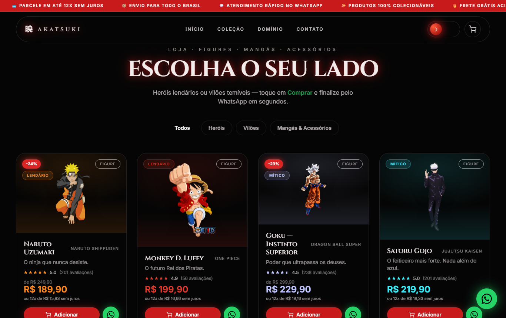
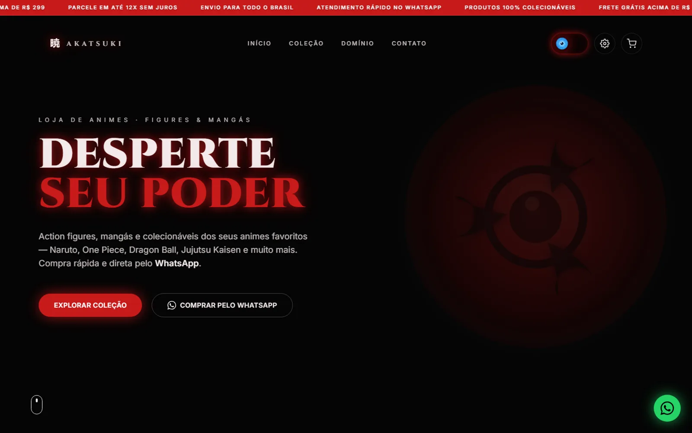

[English](README.md) · **Português**

# 暁 AKATSUKI — Loja de Animes

Loja de animes cinematográfica em 3D — **action figures, mangás e colecionáveis** de heróis e vilões de animes, com checkout direto pelo **WhatsApp**. Visual com lua vermelha, partículas, dois temas (Akatsuki / Expansão de Domínio) e **aura de energia por personagem** ao adicionar ao carrinho.

> **Tipo:** demonstração comercial fan-made (projeto de portfólio) · **Demo:** https://akatsuki-loja-animes.vercel.app
>
> **Aviso:** este é um projeto **fan-made e não oficial**. "AKATSUKI" é uma marca fictícia de loja. Os personagens, nomes, obras e marcas exibidos (Naruto, One Piece, Dragon Ball, Jujutsu Kaisen, Demon Slayer, Attack on Titan etc.) pertencem aos seus respectivos detentores de direitos; este projeto **não tem afiliação, patrocínio nem aprovação** deles. Produtos, preços, avaliações e estoque são **ilustrativos**.





---

## Funcionalidades

- **Catálogo** — 33 figures (18 heróis + 15 vilões) e 8 colecionáveis (mangás, miniaturas e acessórios), definidos em `lib/products.ts`.
- **Página de produto** — `/produto/[id]`, gerada estaticamente para cada item.
- **Carrinho** — adicione vários itens e finalize tudo numa **única mensagem de WhatsApp**; persiste no `localStorage`. Ao adicionar, o card dispara a aura do personagem e o carrinho abre mostrando o item.
- **Compra direta** — botão de WhatsApp em cada card com mensagem pré-preenchida (produto + preço).
- **Filtros** — Todos / Heróis / Vilões / Mangás & Acessórios.
- **Cara de e-commerce** — barra de promoções, faixa de benefícios, badge de desconto, estrelas de avaliação (valores ilustrativos), parcelamento em 12x e tag de frete grátis.
- **Dois temas cinematográficos** — *Akatsuki* (escuro, lua vermelha) ⇄ *Expansão de Domínio* (claro, energia azul), com transição animada.
- **Aura de energia por personagem** — ao adicionar ao carrinho, o card dá um *punch* (tremor + zoom) e sobem chamas na cor "lore" do personagem (mapeada em `lib/aura.ts`). Enquanto o item está no carrinho, o card mantém uma aura pulsante.
- **Painel de desempenho** — Auto / 3D / Leve (o modo leve desliga o WebGL em aparelhos modestos).
- **Cursor Esfera do Dragão** — cursor personalizado opcional (desktop).
- **Cena 3D** — fundo com lua, névoa, partículas e parallax pelo movimento do mouse.
- **SEO** — metadata, OpenGraph gerado (`app/opengraph-image.tsx`), `robots.txt`, `sitemap.xml` e JSON-LD.

## Stack

Next.js 14.2 (App Router) · React 18 · TypeScript · Tailwind CSS 3 · Three.js · React Three Fiber · drei · Framer Motion · GSAP · Lenis · shaders GLSL.

## Rodando localmente

Pré-requisitos: Node.js 18.17+ (testado com Node 22) e npm.

```bash
npm ci
npm run dev      # http://localhost:3000
```

Build de produção:

```bash
npm run build && npm start
```

Não há variáveis de ambiente.

> A cena 3D precisa de **WebGL com GPU**. Em ambientes sem GPU (alguns headless), o fundo 3D pode aparecer preto — abra num navegador normal ou use o modo Leve.

### Scripts

| Script | O que faz |
| --- | --- |
| `npm run dev` | Servidor de desenvolvimento |
| `npm run build` | Build de produção (inclui checagem de tipos) |
| `npm start` | Serve o build de produção |
| `npm run lint` | `next lint` — o ESLint ainda **não está configurado** neste projeto |

## Como personalizar

### URL do site
`lib/site.ts` define `SITE_URL`, usada em canonical, OpenGraph, sitemap, robots e JSON-LD. Troque pelo seu domínio.

### Número do WhatsApp
Na demo, os links de compra apontam para o WhatsApp comercial da MilWeb. Para usar o seu, edite `lib/whatsapp.ts`:

```ts
export const WHATSAPP_NUMBER = "55DDNNNNNNNNN"; // 55 + DDD + número
export const WHATSAPP_DISPLAY = "(DD) NNNNN-NNNN";
```

### Produtos
Tudo fica em `lib/products.ts`. Cada produto:

```ts
{
  id: "naruto",
  name: "Naruto Uzumaki",
  character: "Naruto Uzumaki",
  anime: "Naruto Shippuden",
  kanji: "渦",
  category: "Figure",            // Figure | Mangá | Miniatura | Acessório
  side: "hero",                  // hero | villain (opcional)
  tagline: "O ninja que nunca desiste.",
  price: "R$ 189,90",
  oldPrice: "R$ 249,90",         // opcional — gera o badge de desconto
  rarity: "Lendário",            // Comum | Raro | Lendário | Mítico
  hue: "#ff8a1e",                // cor de destaque do card
  image: "/characters/naruto.png", // opcional — sem imagem mostra um card com o kanji
}
```

### Imagens
- Personagens: `public/characters/<id>.png` (renders com fundo transparente).
- Capas de mangá: `public/manga/<id>.jpg`.

Basta substituir o arquivo (mesmo nome) ou apontar outro caminho em `image`.

### Aura por personagem
A cor da aura fica em `lib/aura.ts` (`auraFor`), mapeada por `id`; quem não está no mapa usa a cor `hue` do produto. A animação vive em `components/ProductCard.tsx`.

## Estrutura

```
app/                     # App Router (layout, página, produto/[id], OG image, robots, sitemap)
components/
  scene/                 # Cena 3D (Canvas, lua, partículas, nuvens, shaders GLSL)
  sections/              # Hero, Benefits, Products, Domain, Ritual (rodapé)
  product/               # Página de produto (detalhe, preço, badges, aura)
  eyes/                  # Olhos animados dos temas
  CartProvider / CartDrawer / CartButton   # Carrinho
  ProductCard            # Card de produto + aura por personagem
  ThemeProvider / ThemeToggle / TransitionOverlay  # Temas + transição
  PerfModeProvider / SettingsMenu          # Modo de desempenho
lib/
  products.ts            # Catálogo
  aura.ts                # Cor da aura de cada personagem
  whatsapp.ts            # Link e mensagens do WhatsApp
  format.ts              # Preço, parcelamento, desconto, avaliação
  site.ts                # URL canônica
public/
  characters/            # Imagens dos personagens
  manga/                 # Capas de mangá
docs/screenshots/        # Capturas usadas neste README
```

## Limitações

- Não há backend, pagamento, estoque nem painel administrativo: o pedido é só uma mensagem de WhatsApp.
- Preços, descontos e avaliações são estáticos e ilustrativos.
- Sem testes automatizados e sem ESLint configurado.

## Créditos das imagens

As imagens de personagens (`public/characters/`) e as capas de mangá (`public/manga/`) são arte de terceiros ligada às obras originais, usada apenas como referência visual nesta demonstração; a origem exata dos arquivos não está documentada. Todos os direitos pertencem aos respectivos detentores. Para qualquer uso real, substitua por imagens próprias ou devidamente licenciadas.

## Deploy

Pensado para a [Vercel](https://vercel.com): importe o repositório — `npm run build` roda sem configuração extra.

## Segurança

Veja [SECURITY.md](SECURITY.md).

## Licença

Ainda não há licença definida; todos os direitos reservados ao autor. Isso vale apenas para o código e o design originais deste projeto — personagens e marcas de terceiros continuam pertencendo aos seus detentores.
